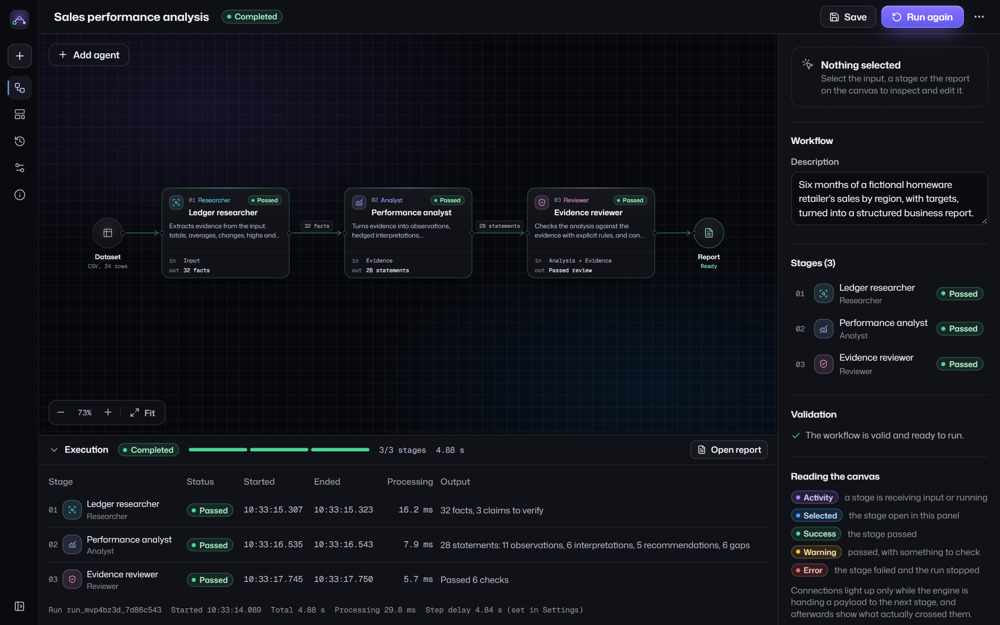
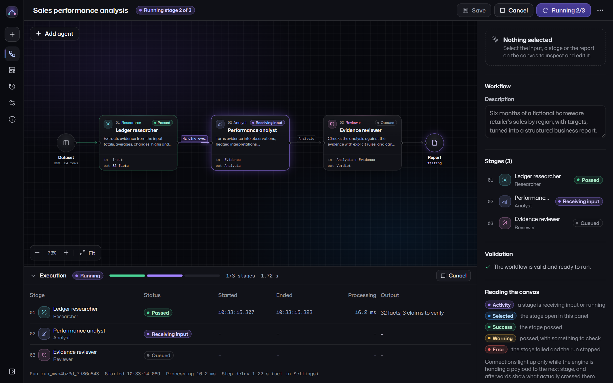
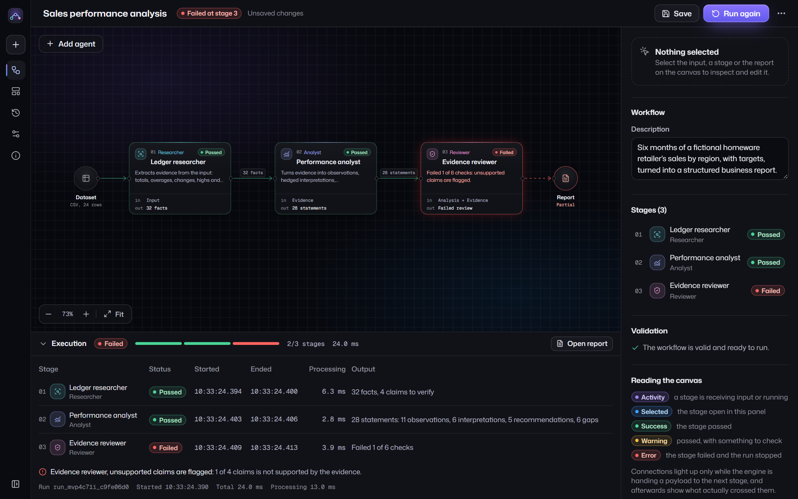
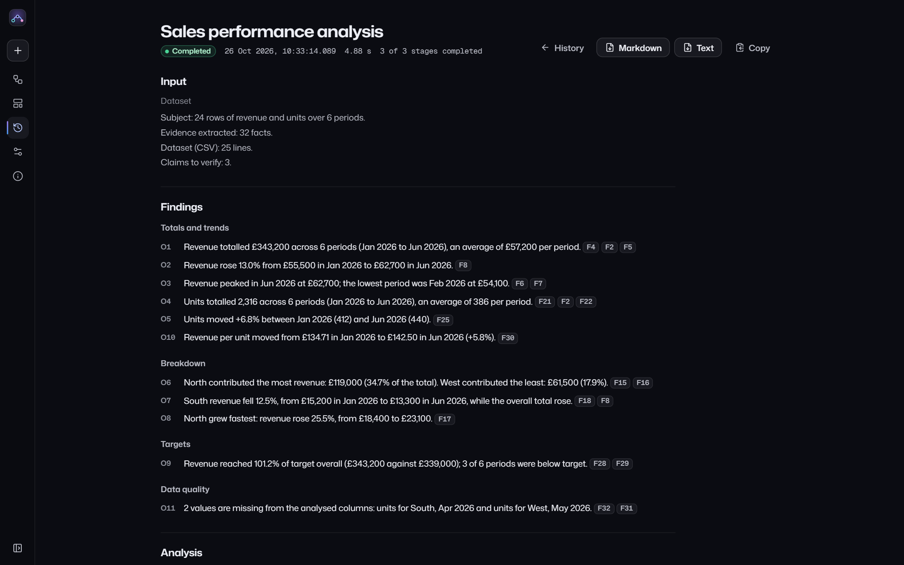
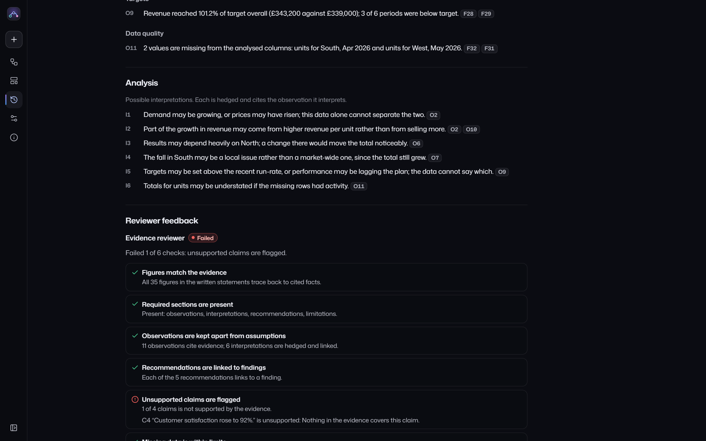
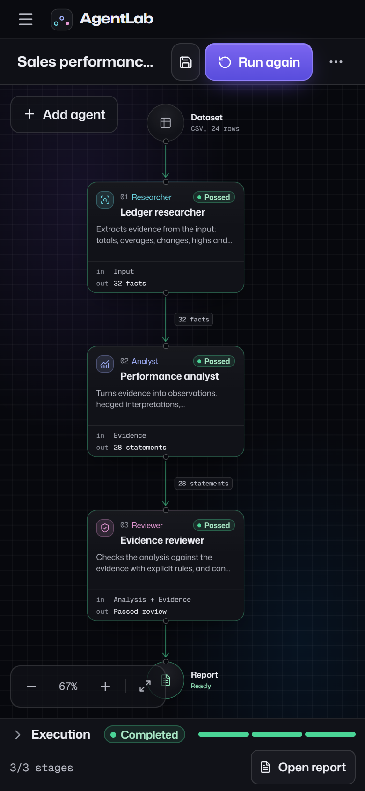

# AgentLab

A visual workspace for building, running and inspecting workflows of specialised agents.

**Live:** https://agentlab-ww.netlify.app

AgentLab is a **workflow engine with deterministic processing**, for experimenting with agent-style workflows. You chain agents (Researcher → Analyst → Reviewer), run them in order, and see exactly what each one received and produced, down to the evidence behind every figure in the report. Version 1 calls **no AI model**. Every agent is TypeScript with explicit, readable rules, so the same input always produces the same output.



## Features

- **Canvas workspace.** Agent cards and directional connections, with pan, zoom, pinch and fit-to-view. The layout is derived from the workflow order, so the picture always matches what the engine runs. Connections animate only while the engine is handing a payload to the next stage. Afterwards they show what actually crossed them ("32 facts", "28 statements"), and they look different when the run completed, failed or skipped a stage.
- **Four roles with typed contracts.** Researcher (evidence extraction), Analyst (rule-based analysis), Reviewer (validation gate) and Summariser (a short brief). A workflow whose contracts don't line up, such as an Analyst placed before any Researcher, is rejected before it runs, with a specific reason.
- **Instructions that change behaviour.** Lines written as `key: value` are directives the agent runs, for example `threshold: 10%`, `focus: revenue, units` or `unsupported claims: fail`. Every other line is kept as a note, and the inspector labels it as not executed.
- **A Reviewer that can fail.** It pulls every figure back out of the written analysis and checks it against the facts the statement cites. It also checks that required sections are present, that observations are kept apart from assumptions, that recommendations link to findings, and it verifies claims. Any failed check stops the run at that stage.
- **Execution drawer.** Per-stage status, real start and end times, processing time, output summaries, warnings, errors and review checks.
- **Reports.** Input summary, findings, analysis, reviewer feedback, recommendations, limitations, stage trace and the full evidence table, with statement and fact ids linked. Exports to Markdown or plain text. A failed or cancelled run produces a partial report that says where it stopped and is never shown as a success.
- **History, saves and settings** in `localStorage`. Reads tolerate malformed or older data: bad entries are repaired or skipped, and the app says so.
- **Three bundled examples**, all fictional and needing no API key: a sales dataset, a written website description checked against a prioritised checklist, and a social post checked against editorial rules and verified facts.

| Mid-run hand-off | A run the Reviewer failed |
|---|---|
|  |  |

| Report | Failed-run report | Phone |
|---|---|---|
|  |  |  |

## Stack

React 19, TypeScript 5.9, Vite 8, Tailwind CSS 4, Zustand 5, wouter 3, Lucide icons, Mona Sans and Geist Mono (self-hosted via Fontsource). Vitest for engine tests, Python Playwright driving Microsoft Edge for browser tests. Hosted as static files on Netlify.

## Getting started

```bash
npm install
npm run dev        # http://localhost:5620
npm run build      # typecheck, then build to dist/
npm run preview    # serve dist/ on http://localhost:5621
npm test           # engine unit tests (Vitest)
```

Browser tests run against the production build. They need Python 3 with `playwright` installed, plus Microsoft Edge:

```bash
npm run build
python tests/e2e/test_agentlab.py                     # 20 end-to-end checks
python tests/e2e/verify_live.py https://agentlab-ww.netlify.app
python tests/e2e/readme_shots.py                      # regenerates docs/screenshots
```

## Architecture

```
src/
  engine/              Plain TypeScript, no UI imports
    types.ts           Workflow definitions, agent configs, payloads, events, run records
    contracts.ts       Role contracts and static validation
    directives.ts      Instruction parsing: directives vs notes vs errors
    engine.ts          Orchestration: order, events, errors, cancel, concurrency guard
    processors/        Researcher (dataset, website, content), Analyst, Reviewer, Summariser
                       ai-seam.ts: the interface a future AI processor would implement
    claims.ts          Claim verification against evidence
    numbers.ts         Number formatting and extraction, shared so rounding agrees
    report.ts          Report builder and Markdown/text export
  state/               Zustand store; localStorage persistence with repair
  components/          Canvas, inspector, execution drawer, shell, output views
  pages/               Workspace, Templates, History, Report, Settings, About
tests/e2e/             Playwright (Python) browser tests, live smoke test, screenshot script
```

The interface only hands the engine a workflow definition and listens to the events it emits (`run-started`, `handoff`, `stage-started`, `stage-finished`, `report-handoff`, `run-finished`). Each event carries a snapshot of the run record, so the UI never reaches into engine internals.

### Why not React Flow

I evaluated React Flow (v12, `@xyflow/react`). It handles read-only graphs well, with `nodesConnectable={false}`, `fitView` and keyboard-focusable nodes. But its main strengths are free node positioning and user-drawn connections, and AgentLab deliberately has neither: v1 is strictly sequential, and the graph must equal the definition. A small custom canvas (pan, wheel and pinch zoom, fit-to-view, about 250 lines) gives full control over the connection rendering that carries the run state, keeps the bundle smaller, and leaves no way to draw a connection the engine would ignore.

## Execution model

1. **Validate.** Each role declares what it consumes and produces: Researcher `input → evidence`, Analyst `evidence → analysis`, Reviewer `analysis + evidence → review`, Summariser `analysis → summary`. Directives are parsed. Any error rejects the run before it starts.
2. **Run in order.** Each stage receives the envelope built so far and adds its output. The engine records the status, input source, output, warnings, errors and real start and end times for every stage.
3. **Stop at the first failure.** A processing error (for example a CSV with no numeric columns) or a failed review marks that stage failed. Later stages are marked skipped.
4. **Build the report** from the recorded outputs only.

Processing itself takes milliseconds. The optional **step delay** (Settings) is a visible pause before each stage so the hand-offs can be followed. It is recorded and reported separately from processing time.

Runs can be cancelled between stages and restarted. The engine refuses a second concurrent run of the same workflow; the UI disables the button too, but the guard lives in the engine.

### Traceability

The Researcher gives every fact an id (`F12`). Observations cite facts, interpretations cite observations, and recommendations cite either. Claims supplied with the input ("Total revenue was above £340,000") are carried through unverified, and the Reviewer marks each one supported, unsupported or contradicted. Because the Reviewer re-extracts figures from the prose, it would also catch a number invented by a future AI-backed Analyst.

## Testing

- **Engine (Vitest):** 18 tests covering all three examples end to end, order and hand-off, results changing with input, unsupported and contradicted claims, warn-only mode, empty required sections, a fabricated figure caught by the Reviewer, contract and directive validation, the concurrency guard, cancellation, processing errors, directive-driven behaviour, number extraction, and failed-run reports.
- **Browser (Playwright + Edge, production build):** 20 checks:
  - navigation and direct loads of every route
  - creating a workflow and adding, renaming, reordering (including an invalid order), removing and undoing agents
  - running all three examples and checking stage order and hand-off
  - an unsupported claim failing the Reviewer, and a processing error failing a run
  - cancel, history, Markdown and text export, saves persisting across a reload, and confirmations for delete and clear-history
  - malformed stored data being tolerated
  - reduced motion, visible keyboard focus, and no horizontal scroll at 1440, 1280, 768 and 390 px
  - the mobile drawer and inspector sheet with touch-sized targets
  - no secrets in `dist/`, no console errors, and no requests to other hosts
- **Lighthouse 13.5** on the live site (headless Edge, one run each, 26 Oct 2026): desktop 99 performance, 100 accessibility, 100 best practices, 100 SEO. Mobile (simulated throttling) 87 performance, 100 accessibility, 100 best practices, 100 SEO. Full reports: [`docs/lighthouse-desktop.html`](docs/lighthouse-desktop.html), [`docs/lighthouse-mobile.html`](docs/lighthouse-mobile.html).

## Deployment

A static build on Netlify:

```bash
npm run build
netlify deploy --prod --dir dist --site <site-id>
```

`public/_redirects` serves `index.html` for client routes and returns a real 404 for missing files under `/assets/`. `public/_headers` sets a strict Content Security Policy (scripts, fonts and connections are same-origin only) and long-lived caching for hashed assets.

## Limitations

- No AI model is used. Free-text notes in instructions are recorded, not executed.
- v1 is sequential: no branching, parallel stages or loops.
- The website review works from a written description. It never visits or measures a live site.
- Claim matching is rule-based: figures, comparisons (above or below), direction (rose or fell) and named rankings. It can't judge claims without figures, so it marks them unsupported rather than guessing.
- Dataset analysis expects a header row and, for trend facts, a period column. Large files aren't optimised.
- All data stays in one browser's `localStorage`. There's no sync, sharing or account.

## Future ideas

- AI-backed processors behind a server endpoint (no keys in the client), still checked by the same Reviewer.
- Branching and parallel stages, with contracts checked per edge.
- CSV file upload and more input types.
- Comparing two runs side by side.

## About

Designed and built by Will Weatherhead. Portfolio: https://willwportfolio.co.uk
